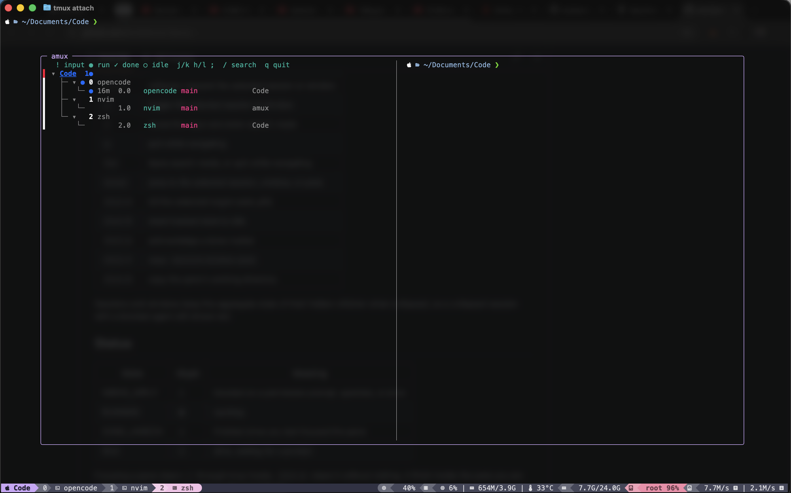

# amux

A tmux popup that shows which panes have an AI agent, what each one is doing, and which
one is blocked waiting on you. `prefix+W` opens a searchable tree of every session,
window, and pane; Enter jumps to the one you picked.

No daemon. No sidebar. No status-line clutter. Hooks write a small state file, the popup
reads it.



```
▾ PROJ-123  🚨 NEEDS  api
  ├─ ▾ 1 claude
  │   ├─ 🚨 NEEDS   2m   1.0   claude   feature/retry   api   why does this test fail?
  │   └─ 🏃 RUNNING 12s  1.1   claude   feature/retry   api   add the retry budget
  └─ ▾ 2 review
      └─ 🏃 RUNNING  8s  2.0   opencode main            api
▾ PROJ-456  web
  └─    0 zsh
      └─ 💤 IDLE 1h  0.0   zsh      main            web
```

Status comes from agent lifecycle hooks, not from parsing pane output or polling
processes. The four states are deliberately few, so the list stays readable when a dozen
agents are running.

## Why

`prefix+w` shows sessions, windows, and panes as undifferentiated text. Once you run
several agents across several worktrees, you cannot tell which pane is working, which one
finished, and which one is sitting on a permission prompt. A persistent sidebar solves
that by permanently stealing screen space and adding a daemon, an inbox, and a second
status UI to keep in sync.

amux solves only the lookup: press one key, see the state of the whole tmux server, type
to filter, jump.

## Features

- Full session/window/pane tree, so it is a real `prefix+w` replacement for navigation.
- Four-state agent awareness: needs input, running, finished-unseen, idle.
- Urgency-first ordering: sessions with a blocked agent float to the top; within a state,
  the most recently used rows come first and old work sinks.
- Collapsible tree with `h`/`l`/`;`, like `choose-tree`.
- Live preview of the highlighted pane, with terminal backgrounds stripped and lines cut
  to the preview width so a full-screen TUI cannot paint over the popup.
- Modal input: the picker opens in navigation mode, and `/` reveals the search field.
- Uses the terminal's ANSI palette and default background, so it follows whatever theme
  (and transparency) the terminal is configured with.
- No background process. State files are namespaced by tmux server PID, so a tmux restart
  cannot resurrect stale pane ids.

## Requirements

- tmux 3.4 or newer (`display-popup`, `after-select-pane`). On tmux 3.8+ the popup
  inherits the terminal background; older versions fall back to the configured popup
  style.
- fzf 0.71 or newer (tested with 0.74); the open popup refreshes itself and keeps the
  selection across reloads.
- Go 1.24 or newer to build.
- OpenCode v2 for the OpenCode adapter (v1 plugins are a different API).

## Install

```sh
git clone https://github.com/davidalecrim1/amux
cd amux
make install       # builds to ~/.local/bin/amux
amux setup         # wires tmux, Claude Code, and OpenCode
```

`amux setup` is idempotent and supports `--dry-run`. It:

1. writes `~/.config/amux/tmux.conf` with `bind W` and the three focus hooks;
2. appends one `source-file` line to `~/.config/tmux/tmux.conf` (or `~/.tmux.conf`);
3. merges the Claude Code hooks into `~/.claude/settings.json`, keeping existing handlers
   and writing a timestamped backup;
4. writes the OpenCode v2 plugin to `~/.config/opencode/plugins/amux.js`.

Then reload tmux and restart Claude Code and OpenCode.

If you prefer to wire it by hand, the generated `~/.config/amux/tmux.conf` is ten lines.

## Keys

The picker opens in navigation mode with the input field hidden. Text is accepted only in
search mode.

| Key | Action |
| --- | --- |
| `j` / `k` | move down / up |
| `g` / `G` | jump to the first / last row |
| `h` / `l` | collapse / expand the selected session or window |
| `;` | toggle the selected session or window |
| `/` | reveal the input and enter search mode |
| `q` | quit while navigating |
| `Esc` | leave search mode, or quit while navigating |
| `Enter` | jump to the selected session, window, or pane |
| `Ctrl-X` | kill the selected target (asks y/N) |
| `Ctrl-R` | reset tracked state to idle |
| `Ctrl-A` | acknowledge a done marker |
| `Ctrl-Y` | copy `session:window.pane` |
| `Ctrl-O` | copy the pane's working directory |

Sessions and windows keep the aggregate state of their hidden children when collapsed, so
a collapsed session with a blocked agent still shows red.

## Status

| State | Marker | Meaning |
| --- | --- | --- |
| NEEDS_INPUT | 🚨 NEEDS | blocked on a permission prompt, question, or error |
| RUNNING | 🏃 RUNNING | working |
| DONE_UNSEEN | ✅ DONE | finished since you last focused the pane |
| IDLE | 💤 IDLE | alive, waiting for a prompt |

Markers are an emoji plus an uppercase word, with no background color. Status lives on the
agent's pane, not on the window above it: a window with one nvim pane and one opencode pane
badges only the opencode row. A session shows its worst state when it contains more than one
agent, or when it is collapsed; a window shows its state only when collapsed. Focusing a pane
clears `DONE` through tmux hooks. `Ctrl-A` clears it without visiting. A finish inside the
pane you are currently looking at is recorded as idle immediately.

## Agents

### Claude Code

`amux setup` installs handlers for `SessionStart`, `UserPromptSubmit`, `PreToolUse`,
`PostToolUse`, `PostToolUseFailure`, `PermissionRequest`, `PermissionDenied`,
`Notification`, `Stop`, `StopFailure`, and `SessionEnd`.

The adapter keeps a turn running when `Stop` reports background tasks, treats permission
requests and API failures as needs-input, and deletes the record on `SessionEnd`. Hooks
never block the agent: they always exit zero and absorb their own errors.

### OpenCode

The generated plugin subscribes to the OpenCode v2 event stream. Prompts, tool calls, and
`session.execution.started` mark running; `session.execution.succeeded` or
`interrupted` mark done; `session.execution.failed` marks needs-input with the error type;
`permission.asked` marks needs-input; `session.deleted` removes the record. The v2 stream
uses `session.execution.*`; `session.idle` and `session.status` remain as fallbacks.

OpenCode v2 runs a long-lived `opencode serve --service` process, so the plugin's
`TMUX_PANE` can point at a pane that has already been closed. The adapter therefore
resolves the live pane by directory: the service's launch directory first, then the
plugin's project directory, preferring the pane that is actually running `opencode`.

### Anything else

```sh
echo '{"pane_id":"%3","agent":"aider","state":"running","prompt":"fix the parser"}' | amux report
```

Valid states are `needs_input`, `running`, `done_unseen`, `idle`, and `gone` (delete).
`pane_id` defaults to `$TMUX_PANE`.

## How it works

```
Claude hooks ─┐
              ├─> amux hook / amux report ─> ~/.local/state/amux/<server-pid>/<pane>.json
OpenCode  ────┘                                        │
                                                       ▼
tmux list-panes -a ──────────────> amux pick (fzf) ─> jump / kill / reset / ack / copy
tmux focus hooks ─> amux focus ──> state files
```

The picker reconciles at open time: records for panes that no longer exist are deleted,
and records are namespaced by the tmux server PID. State is written atomically, one file
per pane. Nothing survives the command.

## When something looks wrong

```sh
amux doctor
```

It reports the binary and state paths, tracked records, orphaned records, whether the tmux
hooks are installed, and whether the Claude and OpenCode integrations are present.

A RUNNING agent with no events for a long time is usually an interrupted turn whose `Stop`
hook never fired. The age column makes it visible; `Ctrl-R` clears it.

## Non-goals

No daemon, sidebar, status line, unread inbox, park/wait modes, notifications, remote
monitoring, or session deploy. See [docs/SCOPE.md](docs/SCOPE.md).

## Development

```sh
make test
make vet
make build
```

## License

MIT. See [LICENSE](LICENSE).
